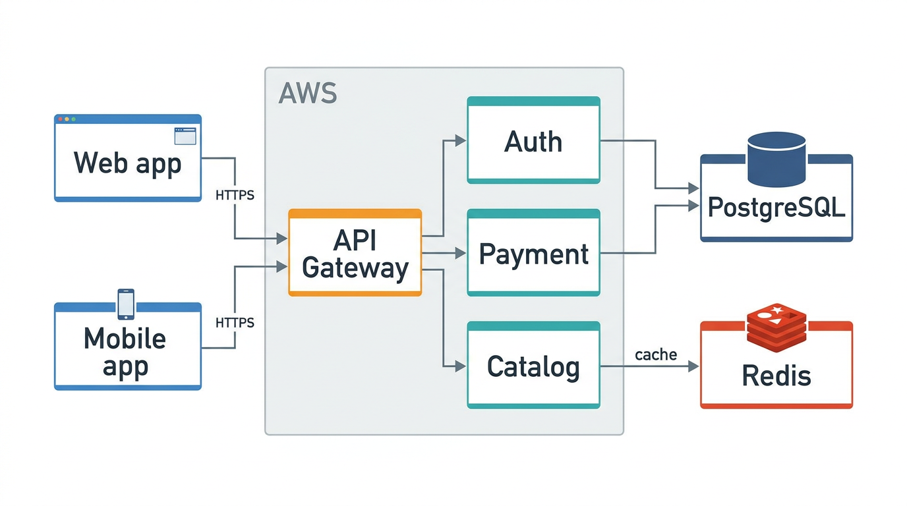
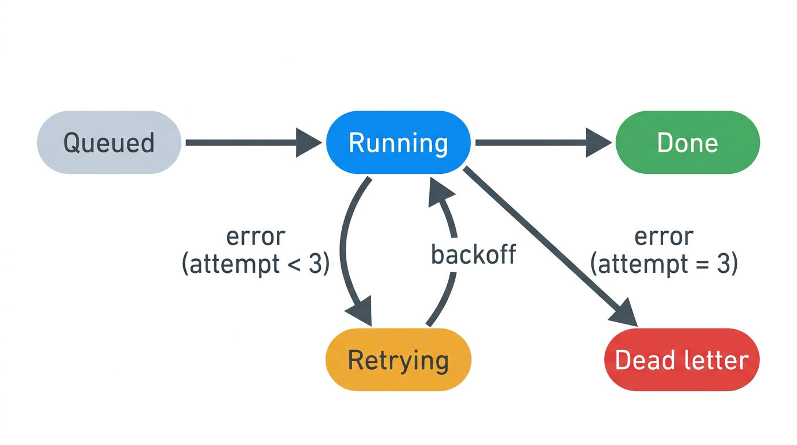
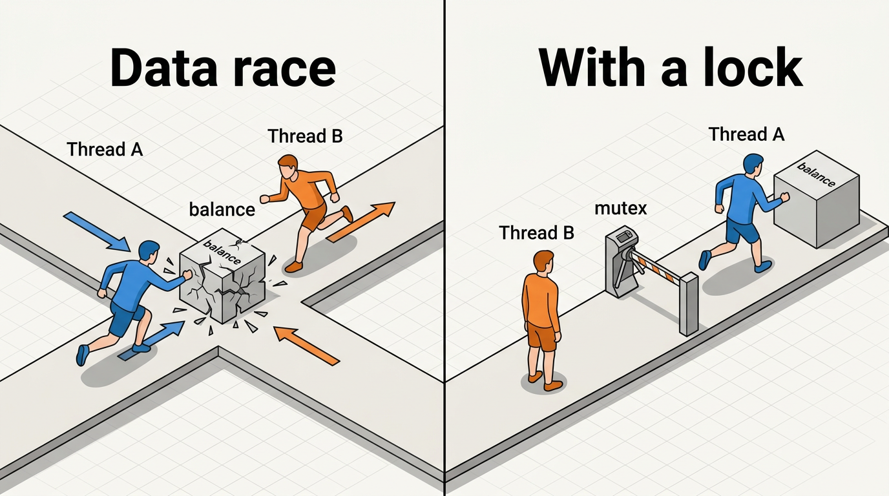

# visual-thinker

コーディングエージェントが、**説明の途中で図を描けるようにする** [Agent Skill](https://agentskills.io) です。
Claude Code（や Codex、`SKILL.md` を読むどのエージェントでも）にシステムの組み立てを聞くと、まず図を出し、
それから図の領域ごとに説明します。

English: [README.md](README.md)（英語版が正で、食い違ったら英語版が正しい）

| 構成図 | 状態遷移 | たとえの図 |
|---|---|---|
|  |  |  |

*このスキルで生成したもの（Vertex AI、`gemini-nano-banana-2.1`）。
[prompt_recipes.md](skills/visual-thinker/references/prompt_recipes.md) の例 A・C・D から作り、最初の2枚には
`--style "white background, flat vector, large readable text"` を付けた。*

## なぜ

システムは、文章より図のほうがずっと早く分かる開発者がたくさんいます。エージェントは一日中、構成やリクエストの
流れや状態遷移を説明していますが、それは文章か、箱と矢印しか描けない Mermaid です。このスキルはエージェントに
次のものを与えます:

- **いつ描くか**: 図を頼まれたとき（「図で説明して」「draw it」）や、文章では追いにくい説明のときに描くよう、
  スキルの説明に書いてあります。
- **何を頼むか**: 6つの種類（`architecture`、`flow`、`state-machine`、`mental-model`、`ui-wireframe`、`generic`）と、
  図のためのプロンプトの書き方: まず配置、短く正確なラベル、向きのある矢印、意味で決める色。
- **どう答えるか**: 図を先に、図に沿った箇条書き、ラベルの誤字や逆向きの矢印がないかの確認、正確な構造が大事な
  ときは Mermaid やコードを並べる。
- **小さな生成スクリプト**: Python の1ファイル、標準ライブラリだけ。入れるパッケージはありません。

## 導入

### Claude Code（プラグイン）

```text
/plugin marketplace add marcosanyo/visual-thinker
/plugin install visual-thinker@visual-thinker
```

### Claude Code、Codex、ほかのエージェント（スキルをコピー）

```bash
git clone https://github.com/marcosanyo/visual-thinker
cp -r visual-thinker/skills/visual-thinker ~/.claude/skills/      # Claude Code、すべてのプロジェクト
cp -r visual-thinker/skills/visual-thinker .claude/skills/        # Claude Code、このプロジェクトだけ
cp -r visual-thinker/skills/visual-thinker ~/.codex/skills/       # Codex
```

ほかのエージェントでは、`skills/visual-thinker/` を、そのエージェントがスキルを読む場所にコピーします。

## 画像のプロバイダーを設定する

**1つ**のプロバイダーの認証情報を設定します（シェルか、実行するディレクトリの `.env` に）:

| プロバイダー | 認証情報 | モデル | 作者が試したか |
|---|---|---|---|
| `vertex`（Google Vertex AI） | `GOOGLE_CLOUD_PROJECT` と `gcloud auth login`（または `VERTEX_ACCESS_TOKEN`） | 既定 `gemini-nano-banana-2.1` | 試した |
| `gemini`（Gemini Developer API） | `GEMINI_API_KEY` | `--model` が必須 | 試していない |
| `openai`（OpenAI Images API） | `OPENAI_API_KEY` | `--model` が必須 | 試していない |
| `openrouter` | `OPENROUTER_API_KEY` | `--model` が必須 | 試していない |

2つ以上設定してあるときは、`--provider` か `VISUAL_THINKER_PROVIDER` で選びます。モデルは `VISUAL_THINKER_MODEL`、
Vertex のリージョンは `VERTEX_AI_LOCATION`（既定 `global`）で決められます。

## 使う

頼むだけです:「このリポジトリの認証の仕組みを、図つきで説明して」。エージェントが生成スクリプトを動かします。
自分で動かすこともできます:

```bash
python3 skills/visual-thinker/scripts/generate_diagram.py \
  --type flow \
  --prompt "Numbered steps 1 to 3, left to right: 'Browser' -> 'API Gateway' -> 'Lambda'. Step labels 'HTTPS', 'invoke'." \
  --style "white background, large readable text" \
  --open
```

| オプション | 意味 |
|---|---|
| `-p, --prompt` | 何を描くか: 部品、つながり、正確なラベル（必須） |
| `-t, --type` | 種類: `architecture`（既定）、`flow`、`state-machine`、`mental-model`、`ui-wireframe`、`generic` |
| `--provider`、`-m, --model` | 上の表を参照 |
| `-a, --aspect` | 縦横比、既定 `16:9` |
| `--style` | 見た目の追加の指定 |
| `-o, --output` | 出力するファイル（既定 `.visual-thinker/diagram_<type>_<time>.png`） |
| `--open` | システムの画像ビューアーで開く（macOS、Windows、`xdg-open` のある Linux） |
| `--dry-run` | API を呼ばずに、組み立てたプロンプトを表示する |

### エラーは隠さずに出す

1回の実行で使うのは、1つのプロバイダーと1つのモデルだけです。呼び出しが失敗したら（認証情報がない、403、404 の
モデルなし、上限）、スクリプトはプロバイダーのエラーをそのまま表示し、終了コード 1 で終わります。ほかのモデルや
プロバイダーに切り替えたり、仮の図を描いたりはしません。スキルは、そのエラーをそのまま見せるようエージェントに伝えます。

## 限界

画像モデルは、ラベルを書き間違えたり、矢印を逆にしたり、ない箱を足したりすることがあります。図は直感をつかむために
使い、頼る前に確かめてください。正確でなければならないもの（配線、プロトコルの順序、フィールド名）には、Mermaid、
表、コードを使ってください。スキルも、エージェントに同じことをさせます。

## 構成

```text
.claude-plugin/
  plugin.json            # Claude Code のプラグインの定義
  marketplace.json       # repo そのものをマーケットプレイスとして追加できるようにする
skills/visual-thinker/
  SKILL.md               # エージェントが読むもの: いつ描くか、どう頼むか、どう答えるか
  scripts/generate_diagram.py
  references/prompt_recipes.md
docs/gallery/            # 上の画像
README.ja.md             # この日本語の README
```

## 生まれ

Amazon Developer Hackathon（2026）の期間中に始めました。Fire TV のプロジェクト [FireSense Kids](https://github.com/marcosanyo/FireSenseKids) をコーディングエージェントと作る間、
その文字だけの長い説明や報告は読み解くのが大変だったので、図を先に出して答えさせるようにしました。その習慣をまとめたのがこのスキルで、
途中で FireSense の構成図も描きました。

## ライセンス

[MIT](LICENSE)
